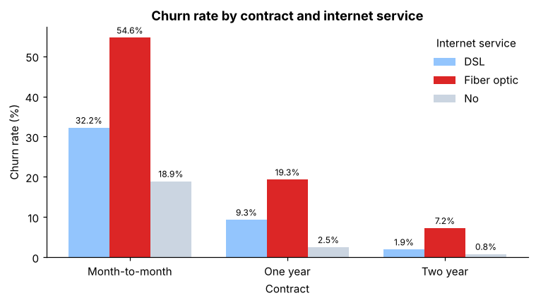
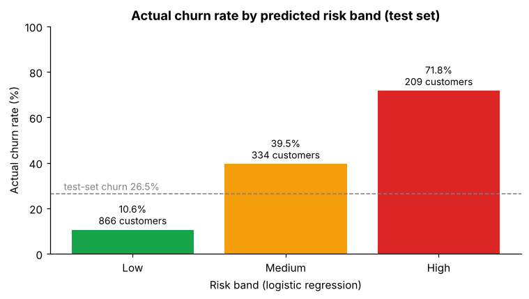

# Telecom Customer Churn Prediction

Predicting which customers of **Simu Connect**, a fictional telecom operator, are likely to leave, so the retention budget goes to customers at risk instead of a blanket discount for everyone.

Python · pandas · scikit-learn · SciPy · matplotlib

Project brief: [DSEAfrica Data Lab: Telecom Customer Churn Prediction in Python](https://www.dataeast.africa/projects/telecom-customer-churn-prediction-in-python)

## Key findings

| | |
|---|---|
| Overall churn | **26.5%** (1,869 of 7,043 customers left last month) |
| Riskiest segment | **Month-to-month + fibre optic: 54.6%** churn (2,128 customers) |
| Contract | 42.7% month-to-month vs 11.3% one-year vs 2.8% two-year |
| Tenure | 47.4% in the first year vs 9.5% after four years |
| Monthly charges | Churners pay $13.18 more per month (Welch t-test p < 0.001, Cohen's d = 0.45) |
| Best model | Logistic regression: **ROC-AUC 0.842** on the test set (5-fold CV 0.846 ± 0.013) |
| High-risk band | **15% of test customers, 72% of them churned, 40% of all churners** |





## What's in the analysis

1. **Load and clean.** `total_charges` is stored as text. Its 11 blanks are all brand-new customers (tenure 0) who haven't been billed yet, so they are filled with 0. A `churned` target (1/0) is added.
2. **Who leaves?** Churn rate overall and by contract, tenure band, internet service and their combinations, with labelled bar charts.
3. **Is the difference real?** A Welch t-test on monthly charges for churners vs stayers, with a confidence interval, effect size, and what the p-value does *not* tell us.
4. **Predict churn.** One-hot encoding inside a scikit-learn `Pipeline` (fitted on training data only, to avoid leakage), a stratified 80/20 split, logistic regression and a depth-4 decision tree, compared with a "nobody leaves" baseline. Includes cross-validation, recall, a confusion matrix, feature importance and threshold trade-offs.
5. **Risk bands.** Logistic-regression probabilities grouped into Low (< 0.30), Medium (0.30–0.60) and High (≥ 0.60), checked against actual churn, plus a profile of the high-risk customers.

| Model | Accuracy | ROC-AUC | Recall (churners) |
|---|---|---|---|
| Baseline: nobody leaves | 73.5% | 0.500 | 0.0% |
| Logistic regression | 80.6% | 0.842 | 55.9% |
| Decision tree (max_depth=4) | 79.2% | 0.829 | 45.2% |

Accuracy is misleading here: predicting that nobody leaves already scores 73.5%. ROC-AUC measures how well a model *ranks* customers by risk, which is what a limited retention budget needs.

## Recommendation

Spend the retention budget on the **High** band first, then Medium, and stop the blanket discount for the Low band, where about 90% of customers stay anyway. Test a **contract-upgrade offer** (a discount or free security/tech-support add-on in exchange for a one-year contract) against a random control group, so the result measures customers actually saved.

Full note for the Head of Customer Retention: [`reports/retention_note.md`](reports/retention_note.md)

## Repository structure

```
├── data/
│   └── telco-customers.csv        # 7,043 customers × 21 columns
├── notebooks/
│   └── churn_analysis.ipynb       # full analysis, runs top to bottom
├── figures/                       # charts saved by the notebook
├── reports/
│   ├── retention_note.md          # one-page note for the Head of Retention
│   └── test_set_risk_scores.csv   # test customers ranked by churn probability
├── src/
│   ├── notebook_source.py         # notebook source (cells marked with # %%)
│   └── build_notebook.py          # rebuilds and executes the notebook
├── requirements.txt
└── README.md
```

## How to run

```bash
git clone https://github.com/<your-username>/telecom-churn-prediction.git
cd telecom-churn-prediction
python -m venv .venv && source .venv/bin/activate   # Windows: .venv\Scripts\activate
pip install -r requirements.txt
jupyter notebook notebooks/churn_analysis.ipynb
```

Run all cells. The notebook finds `data/` whether it is started from the repo root or from `notebooks/`. To regenerate the notebook from the source script instead: `python src/build_notebook.py`.

## Data

IBM [Telco Customer Churn sample dataset](https://github.com/IBM/telco-customer-churn-on-icp4d), Apache License 2.0. The customers are fictional and charges are in US dollars. The DSEAfrica version renames the columns to snake_case (for example `customerID` → `customer_id`, `tenure` → `tenure_months`). It is a single monthly snapshot with no usage or complaint history, which limits what the model can explain. See the limits section of the retention note.
